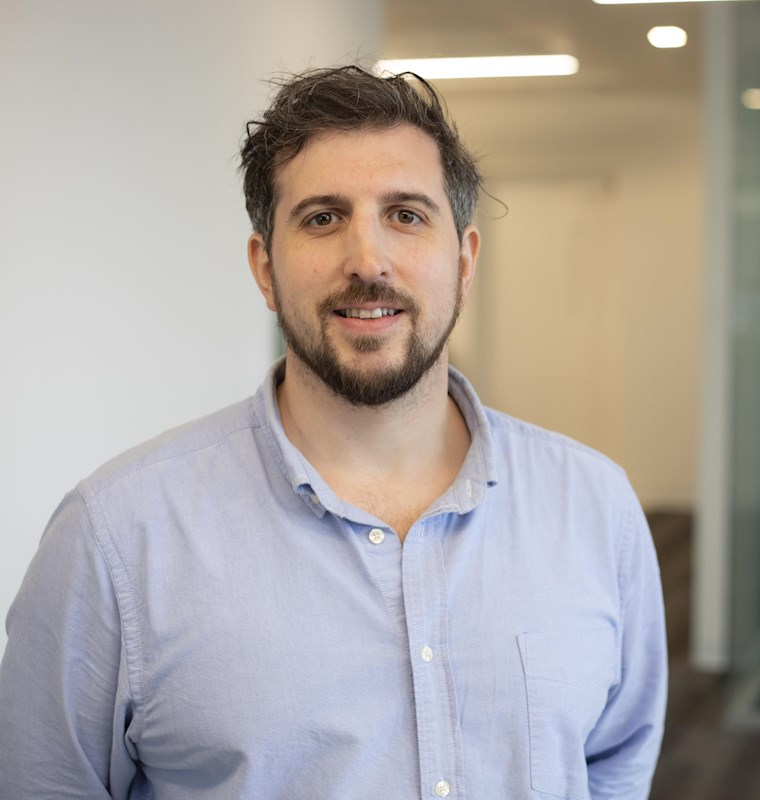
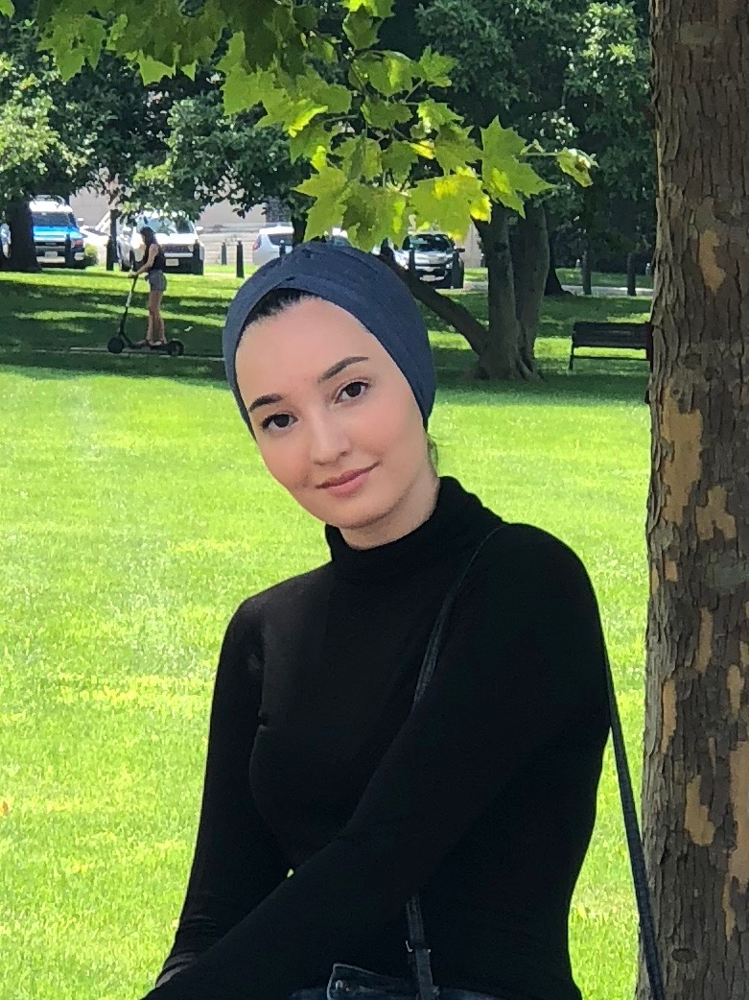
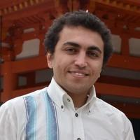

+++
#title = "People"
title = "People"

#date = 2018-09-09T00:00:00
# lastmod = 2018-09-09T00:00:00

draft = false  # Is this a draft? true/false
toc = true  # Show table of contents? true/false
type = "docs"  # Do not modify.

# Add menu entry to sidebar.
#[menu.tutorial]

[menu.people]

#  name = "Lab Members"
#  weight = 1

#[menu.collaborators]
#  name = "Collaborators"
#  weight = 1

+++

## Current Members

---

### Dr. John David Griffiths    
***Group Lead***  

  

Dr. John D. Griffiths is a cognitive and computational neuroscientist based at the Toronto Centre for Addiction and
Mental Health (CAMH)’s Krembil Centre for Neuroinformatics (KCNI; krembilneuroinformatics.ca), where he
leads a research team focused on computational modelling of brain network dynamics, neurostimulation, and
multimodal neuroimaging data (www.grifflab.com). He is an Assistant Professor in the University of Toronto
Departments of Psychiatry, Medical Sciences, and Biomedical Engineering. Originally hailing from North-West
England, Dr. Griffiths completed his PhD at the University of Cambridge, where he worked on structural and
functional neuroimaging of language comprehension and its impairment in ageing and stroke. Prior to this, he
completed his undergraduate training in psychology, philosophy, and cognitive neuroscience at the Universities of
Warwick and York, UK. Subsequently, he worked as a post-doctoral fellow in the groups of Peter Robinson
(University of Sydney School of Physics), Randy McIntosh (Rotman Research Institute) and Jeremie Lefebvre
(Toronto Western Hospital). During this time he conducted research and developed core expertise in multimodal
neuroimaging and macro connectomics, neurophysiological modelling and numerical simulations, neural field
theory, and noninvasive neuromodulation. He also was an early contributor to the The Virtual Brain (TVB)
software library and research consortium. Dr. Griffiths joined the CAMH KCNI as a PI and head of Whole-Brain
Modelling in 2019, where he leads a multidisciplinary team of engineers, physicists, mathematicians, biologists,
and psychologists, working on endogenous oscillations and neurophysiology of noninvasive brain stimulation. The
theory-based work of the group is complemented by novel EEG, fNIRS, TMS, and MRI experiments in healthy
and patient populations.

---

### Minarose Ismail  
***PhD Student***  

Minarose is a PhD student in the Department of Physiology at the University of Toronto, based in Neurosciences & Mental Health at The Hospital for Sick Children. She first joined the lab as a summer research student in 2019. Her research uses personalized whole-brain neurophysiological models of MEG data to study how language lateralization develops in children and adolescents.

---

### Yupeng Tian
***Post-Doctoral Fellow***

Yupeng is a postdoctoral fellow affiliated with the University of Toronto Department of Mathematics, the Fields Institute for Research in Mathematical Sciences (as a Program Postdoctoral Fellow in the Thematic Program on the Mathematics of Neuroscience), and the Krembil Centre for Neuroinformatics. Yupeng's research develops mathematical models of calcium-dependent synaptic plasticity to explain and predict the effects of non-invasive brain stimulation, including transcranial magnetic stimulation (TMS) and transcranial focused ultrasound. Before joining the lab, Yupeng worked on computational models of thalamic deep brain stimulation in Dr. Milad Lankarany's lab.

---

### Dr. Mohamed Abdelhack
***Post-Doctoral Fellow***

Mohamed is a postdoctoral fellow at the Krembil Centre for Neuroinformatics, CAMH, who trained at Kyoto University. Mohamed's research applies large-scale statistics, machine learning, and computational modelling to neuroimaging data to understand mental health and psychiatric disorders, including work on the brain signatures of sleep, depression, and cognition in over 30,000 individuals. Mohamed founded Arabs in Neuroscience, has mentored at Neuromatch Academy and the Imbizo computational neuroscience summer school, and received The Neuro's Open Science Prize for international trainees for this mentoring work.

---

### Jusleen Kaur Mehta

---

## Alumni

- Dr. Davide Momi (Post-Doctoral Fellow, 2021–2025)
- Dr. Neda Kaboodvand (Post-Doctoral Fellow, 2020–2021)
- Dr. Sorenza Bastiaens (Ph.D. Student, 2021–2025)
- Dr. Kevin Kadak (Ph.D. Student, 2020–2025)
- Dr. Shreyas Harita (Ph.D. Student, 2019–2024)
- Taha Morshedzadeh (M.Sc. Student, 2021–2024)
- Parsa Oveisi (M.A.Sc. Student, 2022–2024)
- Andrew Clappison (M.Sc. Student, 2021–2023)
- Frank Mazza (M.Sc. Student, 2019–2021)
- Surya Pandiaraju (Co-op Student, 2020–2021)
