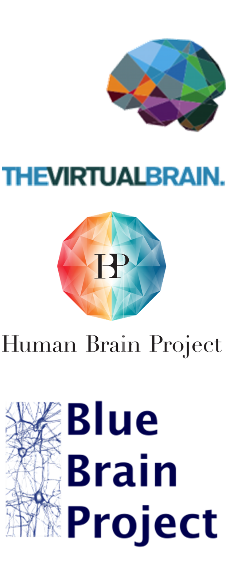
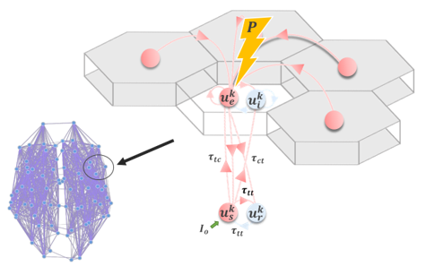
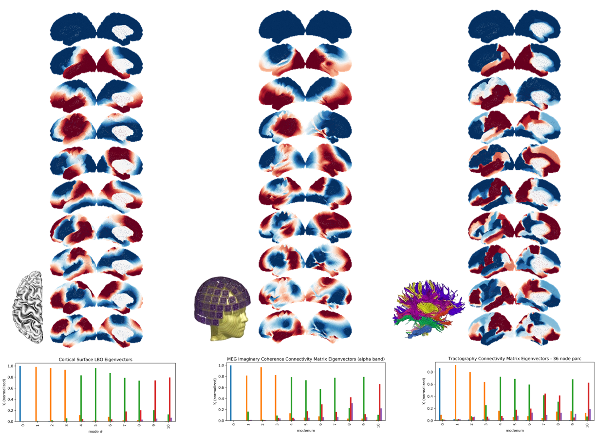

+++
# Project title.
title = "Models & Theory"
weight = 2

# Date this page was created.
#date = 2016-04-27T00:00:00
date = 2019-01-03

# JG_ADD; c.f. hugo.io conversation
showFooter = false

# Project summary to display on homepage.
summary = "Whole-brain, neural mass and neural field models, and the mathematical and computational tools for fitting them to neuroimaging data."

# Tags: can be used for filtering projects.
# Example: `tags = ["machine-learning", "deep-learning"]`
tags = []

# Optional external URL for project (replaces project detail page).
#external_link = ""

# Slides (optional).
#   Associate this project with Markdown slides.
#   Simply enter your slide deck's filename without extension.
#   E.g. `slides = "example-slides"` references 
#   `content/slides/example-slides.md`.
#   Otherwise, set `slides = ""`.
#slides = "example-slides"
# slides = ""

# Links (optional).
url_pdf = ""
url_slides = ""
url_video = ""
url_code = ""

# Custom links (optional).
#   Uncomment line below to enable. For multiple links, use the form `[{...}, {...}, {...}]`.
#url_custom = [{icon_pack = "fab", icon="twitter", name="Follow", url = "https://twitter.com/georgecushen"}]

# Featured image
# To use, add an image named `featured.jpg/png` to your project's folder. 
[image]
  preview_only = true
#  # Caption (optional)
# caption = "transition from a clean alpha-frequency limit cycle to a multi-frequency regime with nested gamma oscillations in a thalamocortical mean field model of EEG activity" 
  
#  # Focal point (optional)
#  # Options: Smart, Center, TopLeft, Top, TopRight, Left, Right, BottomLeft, Bottom, BottomRight
  focal_point = "TopLeft"

+++

Computational modelling is the common thread running through almost all of our work. We develop and apply whole-brain (connectome-based) neural mass models, corticothalamic and neural field models, and detailed cortical microcircuit models, together with the mathematical theory needed to understand their behaviour. A major focus is methodology: fitting models to individual subjects' EEG, MEG and fMRI data using deep-learning-based parameter estimation tools such as [WhoBPyT](/code_and_software/whobpyt/), assessing how much individual-level information these models capture, and making whole-brain modelling more reproducible and accessible through open-source software, tutorials and courses.

<!-- Previous page text, kept for reference (not shown on the site):

 

A main overarching theme of most of the work we do in the WBMG is meso/macroscopic computational models of neural dynamics. We use mathematical models describing neural population activity on the scale of millimetres to centimetres, together with network structure from macaque histology or diffusion MRI fibre tracking, to simulate (approximately) whole-brain activity measurements of the kind measured by fMRI and M/EEG. These techniques are gradually allowing us to obtain more mechanistic insights into observed patterns in neuroimaging data relating to the resting state, oscillations, and the impact of neurological and neurodegenerative disease. Much of our work in this area is done collaboratively with colleagues in the [Virtual Brain](https://www.thevirtualbrain.org/tvb/zwei), [Human Brain](https://www.humanbrainproject.eu/en/), and [Blue Brain](https://bluebrain.epfl.ch/) Projects.

A specific area on which we are focusing is the generation and modulation of fast-timescale brain rhythms, as measured noninvasively by MEG and EEG. 

Together with Dr. Jeremie Lefebvre of the [*Sync* Lab](https://sites.google.com/site/lefebvresynclab/) at the 'other' Krembil Research Institute (UHN Toronto Western Hospital), we have studied how low-frequency rhythms generated by delayed recurrent inhibition in thalamocortical loops interact with higher-frequency rhythms generated by intracolumnar excitatory-inhibitory interactions. 

We find that a thalamocortical loop motif consisting of excitatory and inhibitory cortical neuronal populations, and excitatory (relay) and inhibitory (reticular) thalamic nuclei, can reproduce a large amount of the empirical pheonomena measured with resting state M/EEG. We are now investigating how the topological structure of the cortex interacts with the rhythmogenic properties of this base circuit motif.

A different line of work, done together with Prof. Peter Robinson and colleagues at the University of Sydney, focuses on macroscopic neural field models for large-scale brain dynamics. These are generally formulated in terms of second-order partial differential (wave) equations that are substantially simpler to work with analytically than the stochastic delay-differential equation numerically integrated in TVB simulations. In particular, we have studied the role of the spherical topology and physical embedding of the cerebral cortex on anatomical structure and dynamics. 

This, together with the steady-state eigenmode solutions to the Robinson neural field equations, predicts the presence of spherical harmonic-like patterns in fast-timescale activity measurements. Consistent with this, we have recently shown that this spherical harmonic-like spatial eigenmode structure is observed in cortical surface Laplacians, anatomical connectivity (tractography) networks, (MEG) functional connectivity networks, and numerical simulations. These results provide new insight into the role of the network topology and geometric embedding of the cerebral hemispheres in shaping brain dynamics, as well as the theoretical and practical utility of macroscopic neural field models with spherical boundary conditions.
-->
